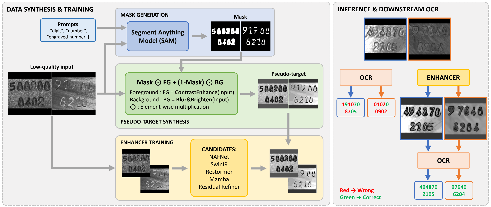
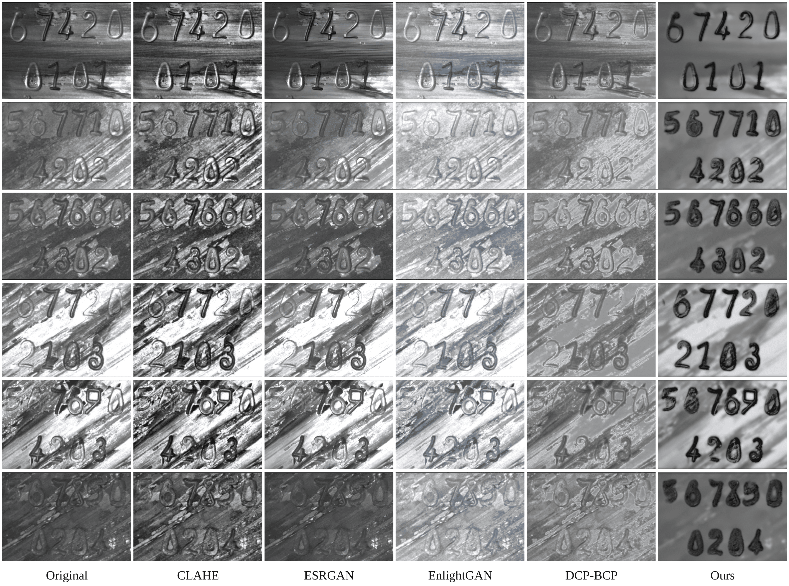
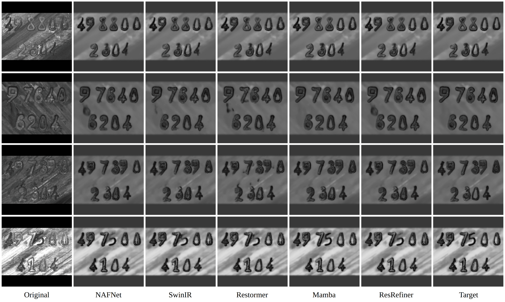
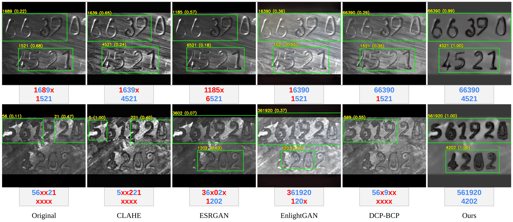

# OCST-MAIE

**OCST-MAIE** is a compact, self-contained inference package for enhancing low-contrast engraved serial numbers before optical character recognition (OCR). It bundles five PyTorch restoration models, their pretrained checkpoints, example images, and an EasyOCR visualization utility.

<p align="center">
  
</p>

## Highlights

- Five pretrained restoration models available through one command-line interface.
- Single-image and folder inference with outputs resized back to the original dimensions.
- A two-stage residual refiner that automatically uses its required NAFNet-Lite base model.
- Optional EasyOCR visualization that writes one bounding-box-annotated image per enhanced input.
- Bundled test images and checkpoints; no external model download is needed.

## Overview

Engraved industrial serial numbers are often difficult to recognize because of weak local contrast, reflective surfaces, texture, and shallow character boundaries. OCST-MAIE trains restoration models with pseudo-targets constructed from segmentation-guided foreground and background transformations. The resulting enhanced images provide more legible input for conventional OCR engines.

The package is intended for **inference and downstream OCR visualization**. All bundled models were trained with `256 x 256` inputs; the inference script restores predictions to the original image dimensions before saving them.

## Visual Results

### Enhancement comparison

<p align="center">
  
</p>

### Comparison of bundled model variants

<p align="center">
  
</p>

### Downstream EasyOCR examples

<p align="center">
  
</p>

## Installation

Use Python 3.10 or newer. From this directory:

```bash
pip install -r requirements.txt
```

For GPU execution, install a CUDA-compatible PyTorch build appropriate for your platform before running the scripts. CPU inference is also supported.

## Model Zoo

All model weights are included in [`weights/`](weights/).

| CLI option | Checkpoint | Description |
| --- | --- | --- |
| `nafnet_lite` | `nafnet_lite_best.pt` | Compact NAF-style U-Net restoration baseline. |
| `restormer_lite` | `restormer_lite_best.pt` | Compact Restormer-style restoration model. |
| `swinir_lite` | `swinir_lite_best.pt` | Compact SwinIR-style window-mixing restoration model. |
| `mamba` | `mamba_raw_to_sam3_best.pt` | Plan 3 Mamba-like directional-scan restorer trained from raw images to pseudo-targets. |
| `residual` | `residual_refiner_best.pt` | Plan 4 residual refiner; automatically runs NAFNet-Lite as its deterministic base stage. |

The `mamba` implementation is a local PyTorch directional-scan model and does not require an external Mamba package.

## Quick Start

Run inference on the bundled `test_images` directory with the Mamba-like model:

```bash
python inference.py --model mamba
```

When neither `--input` nor `--input-dir` is supplied, the script uses `test_images/` and writes results to `outputs/<model>/`.

### Enhance one image

```bash
python inference.py \
  --input test_images/SB7zM8Y8mAGqI5EWHZAH.jpg \
  --model mamba \
  --output outputs/SB7zM8Y8mAGqI5EWHZAH_mamba.jpg
```

### Enhance a folder

```bash
python inference.py \
  --input-dir test_images \
  --model mamba \
  --output-dir outputs/mamba_test_images
```

Supported input formats are JPEG, PNG, BMP, and TIFF. Folder processing loads the selected checkpoint once, handles images in sorted order, and retains each input filename in the output folder.

### Select a device

```bash
python inference.py --input-dir test_images --model residual --device cuda
python inference.py --input-dir test_images --model mamba --device cpu
```

The default `--device auto` uses CUDA when it is available and otherwise falls back to CPU.

## Downstream OCR Visualization

Use EasyOCR to inspect detections on enhanced images. The script saves separate annotated images with green quadrilateral boxes and predicted numeric text; it does not create stacked composites.

```bash
python downstream_ocr.py \
  --input-dir outputs/mamba_test_images \
  --output-dir outputs/mamba_test_images_ocr
```

Useful options include:

```bash
python downstream_ocr.py --gpu
python downstream_ocr.py --no-gpu
python downstream_ocr.py --languages en
```

## Repository Layout

```text
OCST-MAIE/
├── docs/                 # Workflow and qualitative-result figures
├── test_images/          # Example engraved-serial-number images
├── weights/              # Bundled pretrained checkpoints
├── outputs/              # Generated results (ignored by Git)
├── model.py              # Restoration model definitions
├── inference.py          # Single-image and folder inference
├── downstream_ocr.py     # EasyOCR visualization for enhanced outputs
└── requirements.txt
```

## Custom Checkpoints

Use `--checkpoint` to load a compatible checkpoint in place of the selected bundled checkpoint:

```bash
python inference.py \
  --input path/to/image.jpg \
  --model mamba \
  --checkpoint path/to/custom_checkpoint.pt
```

The architecture must match the checkpoint metadata. The built-in `residual` option is recommended for the included Plan 4 residual checkpoint because it automatically constructs the required two-stage inference pipeline.

## Notes

- Generated files in `outputs/` are excluded from version control.
- The test-image filenames are shortened identifiers derived from the original dataset names.
- OCR visualization is intended for qualitative inspection. Recognition accuracy evaluation should use the saved OCR text predictions and ground-truth serial labels.
